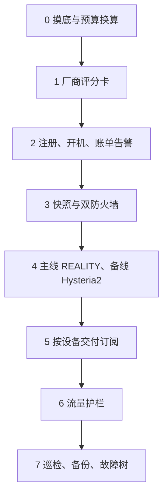
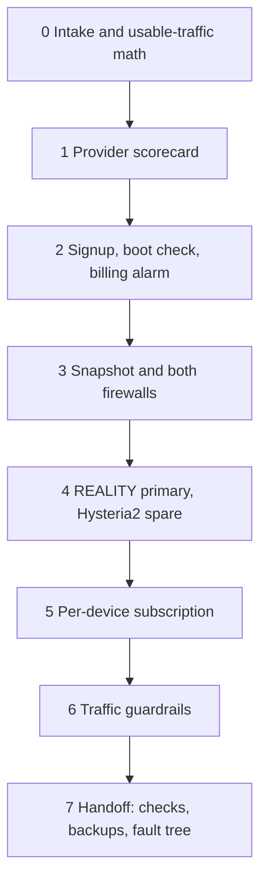

# VPN搭建：自建 VPN、科学上网、机场替代（Grok Bot Agent 模板）

从零搭一条你自己掌控的抗干扰 VPN。这个 Grok Bot agent / AI agent 按月预算硬顶选 VPS，优先住宅 IP / 家宽 IP 出口，主线用 VLESS + REALITY（Xray 或 sing-box），备线用 Hysteria2，再按设备交付 Clash Meta / mihomo、Shadowrocket、v2rayN、NekoBox 能用的订阅链接，并做流量提醒。给人搜索「翻墙」「梯子」时，它对应的是自建，而不是一份共享机场节点。

**检索关键词：** 自建VPN、科学上网、翻墙、梯子、机场替代、VPS、VLESS、REALITY、Xray、sing-box、Hysteria2、WireGuard、Shadowsocks、Clash Meta、mihomo、Shadowrocket、v2rayN、NekoBox、住宅IP、家宽IP、ChatGPT、Claude、Grok、Gemini、不封号、AWS Lightsail、Oracle Cloud、甲骨文、搬瓦工、Vultr、DigitalOcean、订阅链接、流量提醒、Grok Bot agent、AI agent。

仓库里没有服务器地址、密钥、订阅或现成节点。价格和开通结果以你查询当时的厂商文档和社区为准，本文不写死价格，也不写成功率。

## 目录

- [为什么自建VPN（对比机场）](#为什么自建vpn对比机场)
- [助手做什么](#助手做什么)
- [协议矩阵](#协议矩阵)
- [安全规则](#安全规则)
- [支持的客户端](#支持的客户端)
- [怎么用](#怎么用)
- [仓库文件](#仓库文件)
- [常见问题](#常见问题)
- [免责声明](#免责声明)
- [English](#english)

## 为什么自建VPN（对比机场）

机场是许多人共用的代理服务。自建是你名下的 VPS 或住宅出口，协议、防火墙、订阅和账单都在你这边。两边都能完成「科学上网」，差别在出口归谁、日志归谁、容量归谁。

| | 自建 VPN | 机场 |
| --- | --- | --- |
| 出口 IP | 专属于你的机器。访问 ChatGPT、Claude、Grok、Gemini 时，少了一层「和陌生人挤在同一个出口」带来的风控和验证码。 | 热门节点上有大量无关用户。网站看到的是共享 IP 的历史，不由你决定。 |
| 住宅出口 | 可以优先家用宽带 / 住宅 IP。机房 IP 只作备选，并事先说明数据中心网段更容易被当成批量来源。 | 常见是机房 IP。住宅出口是否存在、是否干净，由商家决定。 |
| 费用 | 账单来自云厂商的主机和流量，并且有月预算硬顶，超出的方案直接不推荐。 | 标价可以很低。节点超卖时，速度随别人的用量波动，你看不到容量。 |
| 日志 | 连接记录在你自己的机器上，没有机场侧的第三方日志。 | 商家的面板和中转能看到使用情况，你无法审计对方。 |
| 协议 | 你决定主线、备线和回退：VLESS+REALITY、Hysteria2、必要时经 CDN，或仅在低审查网络使用 WireGuard。 | 协议和伪装随商家的节点走，过时了也只能等对方更新。 |
| IP 被封 | 你可以自己换 IP、切备线，或把入口放到 CDN 后面。换之前助手会先问你。 | 只能在商家给出的节点里换。热门 IP 会反复进入封锁名单。 |
| 速度 | 带宽是你购买的那一台，不和机场用户池互相挤占。实际速度仍取决于线路、时段和协议。 | 晚高峰和超卖会把同一条线路分给远超容量的人。 |

这些是结构性差别，不是测速排名。助手禁止编造价格和成功率，所以这里也不给「省多少」「多稳」之类的数字。

需要提前接受的成本：

- 注册、部署和日后维护要做完。助手一步问一件事，花钱、改防火墙、重启和换 IP 都要你点头。
- 海外云通常要境外支付卡。注册可能失败：同一家最多试两次，然后冷却，大约两天仍不行就换厂商。
- 流量按云厂商规则计费。账单告警很多时候不会自动停机，机器开出来之后仍可能继续扣费，所以要单独设告警。注册成功也不等于一定开得出机器。
- 住宅 IP 减轻的是共享机房出口上的风控和人机验证。ChatGPT、Claude、Grok、Gemini 仍可能因账号、支付方式或使用行为限制功能。没有任何搭建方式可以承诺「不封号」。
- 各地对 VPN 和加密代理的规定不同。动手前先看当地法律。

## 助手做什么

人设在 [`PROFILE.md`](PROFILE.md)。对用户说简体中文，一次只问一件关键的事。能查社区和厂商文档就查，不在对话里粘贴完整密钥，也不发送会被预览的一次性链接。

标准流程是 PROFILE 里的八个阶段（步骤 0 到 7；步骤 0 里包含预算换算 0b）。

1. **摸底（步骤 0）。** 用途、月预算硬顶、预估月流量、运营商和城市、设备、现有客户端、能否使用境外卡或域名、能否接受换厂商。
2. **预算换算（步骤 0b，仍属摸底）。** 按该厂商的流量规则估算「有效流量」再比档位。入站和出站都计入额度时，先把可用的 VPN 流量按大约一半估计。超过月预算硬顶的档位不推荐。
3. **厂商评分卡（步骤 1）。** 比较注册难度、支付、UDP 和 443 是否可用、流量规则、换 IP、有没有住宅或家宽出口、近期 IP 干净度、Home Region。又便宜、又注册不过、开不出机器、或 IP 马上被封的，淘汰。优先住宅出口。候选里可以出现 AWS Lightsail、Oracle Cloud（甲骨文）、搬瓦工、Vultr、DigitalOcean，也可以是别的厂商。没有预设的第一名。
4. **注册（步骤 2）。** 带你完成注册。失败时到 V2EX、X、Reddit 和厂商社区查同类原因并归类。注册前先关掉代理。同一家失败达到两次就停手，冷却大约 24–72 小时；大约 48 小时仍然不行就换一家。成功之后立刻验证能否开机，并设好账单告警。
5. **开机基线（步骤 3）。** 使用静态 IP。云平台防火墙和主机防火墙都要配。运维登录用 SSH 密钥。先打开自动快照，或确认控制台足够当你的逃生口，然后再收掉多余端口，默认不开 80。改防火墙或 SSH 之前，快照或控制台必须已经可用。
6. **协议（步骤 4）。** 主线是 VLESS + REALITY，端口 443。备线是 Hysteria2。源站 IP 被封时，回退到经 CDN 的 VLESS + WebSocket 或 XHTTP。裸 WireGuard 只放在审查较松的网络。部署后用多家运营商分开测 TCP 和 UDP。
7. **交付（步骤 5）。** 按设备推荐客户端，并生成 Clash、sing-box、Shadowrocket 等对应格式的订阅。附上主备切换，以及配置泄露后如何重置。一次性订阅用不会被聊天预览点开的方式交付。
8. **流量护栏与交接（步骤 6 和 7）。** 客户端展示扣费周期和已用流量。接近超额时大约每 5 分钟刷新提醒。限速、切到备线、加机器都要先征得同意。云侧按大约 70%、85%、95% 设告警。交接包括少打扰的巡检、简报、备份，以及一条故障树：端口被封、IP 被封、UDP 不通、订阅格式错误、把自己锁在机器外面、配置泄露。

## 协议矩阵

VLESS 是协议。REALITY 是配在 VLESS 上的 TLS 伪装。Xray 和 sing-box 是实现这些协议的程序。Clash Meta（mihomo）通常是吃订阅的客户端核心。下表是助手的默认选择，不是一份安装脚本。

| 角色 | 选择 | 适合的情况 | 约束 |
| --- | --- | --- | --- |
| 主线 | VLESS + REALITY，TCP 443 | 干扰较强、希望流量看起来像普通 HTTPS | 不用教程里反复出现的热门 SNI。REALITY 的目标站点由助手按当前网络现查，本文不写死域名。 |
| 备线 | Hysteria2 | 主线已经可用，另外需要一条抗丢包的 UDP 备线 | 禁止套在 Cloudflare 橙色云代理后面。运营商封 UDP 时这条线会失效。 |
| IP 被封后的回退 | VLESS + WebSocket 或 XHTTP，经 CDN | 源站 IP 已经进了封锁名单，需要换一个入口 | 多一跳，延迟和故障点都增加。IP 还能直接用时，不拿它当主线。 |
| 低审查网络 | WireGuard | 线路不干扰常见 VPN 握手 | 特征明显。不作为抗干扰默认。 |
| 旧客户端兼容 | Shadowsocks | 设备上只有老客户端 | 在干扰强的网络里比 REALITY 更容易被识别。不作为默认主线。 |

## 安全规则

这些规则来自 PROFILE，助手不能为了「先连上」跳过。

- 月预算是硬顶。双向计流量的厂商，比较档位前先把可用流量按大约一半估算。
- 默认抗干扰组合是 VLESS+REALITY@443，加 Hysteria2 备线。Hysteria2 不走 Cloudflare 橙云。
- 出口优先家用宽带或住宅 IP。只剩机房 IP 时，先说明 AI 服务和验证码方面的风险，再当作备选。
- 公网面板和订阅使用加密通道。禁止明文 HTTP 面板和 HTTP 订阅。
- 一次性订阅不要用普通浏览器打开，也不要发到会抓取链接预览的聊天里。对话中不粘贴完整密钥。
- 改防火墙或 SSH 之前，先有快照或控制台逃生口。默认不开 80。
- 注册云厂商前关掉代理。同一家失败两次就冷却；大约 48 小时仍不行就换厂商。
- 注册成功仍可能开不出机器。账单告警通常不会自动停止扣费。
- 重启服务、改防火墙、花钱加机器、更换 IP，先得到你的同意。
- 价格、库存和「能不能注册」以当时的文档和社区为准。助手不编造数字。

## 支持的客户端

助手按你真正装得上的客户端生成订阅，一种客户端一份配置，而不是一条链接到处导入。

| 常见设备 | 助手会考虑的客户端 | 配置形态 |
| --- | --- | --- |
| Windows | v2rayN；Clash Meta / mihomo | 该客户端自己的订阅或配置 |
| Android | NekoBox；Clash Meta / mihomo | 同上 |
| iOS | Shadowrocket；视系统与安装方式也可选 Clash 系 | 同上 |
| 桌面或路由 | sing-box；Clash Meta / mihomo | sing-box 或 Clash 配置 |

应用商店里有没有某一款，随系统和地区变化。助手先问你现在有什么客户端；没有就从零推荐，并说明主线和备线怎么切换。

## 怎么用

两条路都可以。导入之后，第一场对话应由 [`skills/getting-started/SKILL.md`](skills/getting-started/SKILL.md) 领着走：先说明全程会帮你做什么，然后一次只问一件事（怎么称呼、用什么语言、主要用途、月预算和流量、设备和现有客户端）。摸底够用之后再进入 [`skills/vpn-build-flow/SKILL.md`](skills/vpn-build-flow/SKILL.md)。不要把以前任何主人的服务器信息写进新对话。

### 作为 Grok Bot 模板导入

1. 在 Grok Bot 里用「添加到 Grok Bot」或同等的模板入口，导入这个模板。
2. 核对人设与 [`PROFILE.md`](PROFILE.md) 里的「系统提示词」一致，短介绍可以使用其中的「简介（商店文案）」。
3. 打开设置里的插件 / 技能列表，确认 `getting-started` 和 `vpn-build-flow` 都在，并且已经启用。
4. 新开一轮对话，让它从摸底开始。

模板预览有时能看到技能全文，导入后的 Bot 却没有这两份技能。若列表是空的，用下面的办法补上，人设仍然以 PROFILE 为准。

### 用 PROFILE 和技能重建

1. 新建一个 Grok Bot，名称用「VPN搭建」。
2. 短介绍贴上 PROFILE 的「简介（商店文案）」。人设 / 系统说明贴上「系统提示词」全文。
3. 把 `skills/getting-started/SKILL.md` 的正文交给 Bot，让它创建名为 `getting-started` 的技能；再用 `skills/vpn-build-flow/SKILL.md` 创建 `vpn-build-flow`。
4. 在设置中启用这两个技能。
5. 新开对话。它应先问称呼和语言，而不是直接甩一套安装命令。

这个仓库是人设和流程，不包含一键安装脚本。真正的注册页面、防火墙和订阅生成发生在你和 Bot 的对话里，并且每一步花钱或改门的操作都会先问你。

## 仓库文件

| 路径 | 内容 |
| --- | --- |
| [`PROFILE.md`](PROFILE.md) | 商店简介与系统提示词（硬原则、八阶段流程、行为边界） |
| [`skills/getting-started/SKILL.md`](skills/getting-started/SKILL.md) | 导入后的第一场对话：摸底，再进入搭建 |
| [`skills/vpn-build-flow/SKILL.md`](skills/vpn-build-flow/SKILL.md) | 从选云、注册、部署到订阅和流量护栏 |
| [`LICENSE`](LICENSE) | MIT |

## 常见问题

### 自建VPN和机场哪个好？

取决于你要不要自己维护，以及有没有境外支付方式。

自建适合这些情况：希望出口 IP 不和陌生人共享，以便降低 AI 网站的风控和验证码；希望能选住宅 / 家宽出口；希望费用就是云账单，并被月预算硬顶卡住；希望没有机场那一层日志；希望协议自己定；IP 被封时自己换，而不是等商家补节点；希望速度对应你买下的带宽，而不是超卖池。

机场适合不想碰服务器、没有境外卡、或只想马上拿到一个节点的人。这个模板服务的是前一种选择。它不代售节点，也不比较「谁家机场排名第一」。

### REALITY和Hysteria2怎么选？

默认两条都要：REALITY 做主线，Hysteria2 做备线。

- 干扰强、UDP 不稳定、希望走 443 且看起来像普通 TLS：以 VLESS + REALITY 为主。
- 主线已经通，另外想要一条更抗丢包的 UDP 线：加上 Hysteria2。
- Hysteria2 不要放进 Cloudflare 橙色云。UDP 被封时，备线会一起失效，这时仍靠 REALITY，或改走 CDN。
- 源站 IP 本身被封：换到 VLESS + WebSocket / XHTTP 经 CDN，而不是反复在同一个 IP 上改端口。
- WireGuard 和 Shadowsocks 留在低审查网络或旧客户端上，不替代上面的主线。

### 为什么ChatGPT需要住宅IP？

ChatGPT、Claude、Grok、Gemini 都会看登录来自哪一段网络。机房网段同时被机场、批量注册和自动化脚本使用，因此更常出现验证码、额外检查或功能限制。家用宽带 / 住宅 IP 不在这批共享机房出口里，所以助手把住宅出口放在前面，机房 IP 只作备选。

这解决的是「出口太脏、太共享」。它不保证账号不被限制。账号年龄、支付方式和日常行为仍然算数。搜索词里的「不封号」应理解成人们希望避开共享机房 IP 的风控，而不是一项承诺。

住宅出口指你有权使用的家宽，或厂商明确提供的住宅网络。助手不会把来路不明的代理池当成「住宅 IP」。

### VLESS、Xray、sing-box、Shadowsocks、WireGuard 各是什么？

- **VLESS：** 传输代理协议。本模板的主线是 VLESS 加上 REALITY。
- **REALITY：** 让这条 VLESS 在 443 上完成真实的 TLS 握手外观，用来对抗干扰和主动探测。目标站点不能用满大街教程里的同一个名字。
- **Xray / sing-box：** 服务端（以及部分客户端）上的实现。同一套 REALITY 或 Hysteria2 可以用其中之一部署。
- **Hysteria2：** 基于 UDP 的备线协议，丢包高时往往更稳，UDP 被封则不可用。
- **Shadowsocks：** 老客户端仍能导入。干扰强时它比 REALITY 更容易被识别。
- **WireGuard：** 实现简单、速度好。握手特征明显，只适合低审查网络。
- **Clash Meta / mihomo：** 常见的客户端核心，用来导入订阅，一般不是 VPS 上的服务端。

### AWS Lightsail、甲骨文、搬瓦工、Vultr、DigitalOcean 怎么选？

助手用评分卡，不在仓库里写一个固定冠军。它看的是：注册难度、支付方式、UDP 和 443、流量按单向还是双向计、能不能换 IP、有没有住宅或家宽出口、近期 IP 干净度、Home Region。

AWS Lightsail、Oracle Cloud（甲骨文）、搬瓦工、Vultr、DigitalOcean 都只是可以放进评分卡的例子。最便宜、但注册不过、开不出机器、或 IP 立刻被封的，直接淘汰。免费或试用额度也要设账单告警，因为告警本身往往不会停掉扣费。具体价格让助手在对话时查文档，不要凭这篇 README 做预算。

### Clash Meta、mihomo、Shadowrocket、v2rayN、NekoBox 用哪个？

按设备，不按「哪一个最强」。

- Windows 上常见 v2rayN，也可以用 Clash Meta / mihomo。
- Android 上常见 NekoBox 或 Clash Meta。
- iOS 上常见 Shadowrocket。
- 需要同一份逻辑跑在桌面或路由上时，用 sing-box 或 Clash Meta / mihomo。

助手为每个客户端单独生成订阅，并写清主线和 Hysteria2 备线怎么切。

### 订阅链接为什么不能发到聊天里点开？

一次性订阅 URL 会被聊天软件的链接预览、浏览器历史和缓存请求直接拉走，节点和密钥等于公开。所以助手禁止明文 HTTP 订阅，禁止用浏览器打开一次性链接，也禁止把可点击的一次性 URL 发进会预览链接的对话。交付时改用不会被预览的方式，并提醒你不要为了「看看」去点开。

### 自建之后流量提醒怎么做？

客户端上要能看到扣费周期和已用流量。快到超额时大约每 5 分钟刷新一次提醒。云账单侧按大约 70%、85%、95% 设告警。真的要限速、切备线或再买一台，助手先问你。

比较套餐时：厂商把入站和出站都算进额度的，先按大约一半估计真实能用于 VPN 的流量，再对照月预算硬顶。这是 PROFILE 里的估算规则，用来避免把标称流量当成可用流量，不是某一家云的实测报告。

### IP 被封了，还要换机场吗？

自建的处理顺序在你自己的机器上：确认是端口被封、整个 IP 被封，还是 UDP 被封；能换 IP 就换；TCP 被封而 UDP 仍通可以切 Hysteria2；IP 已经不可用就回退到 CDN 上的 VLESS。这些动作里，换 IP、改防火墙和任何新的花费都要你同意，并且先有快照或控制台。

中途改去买机场，是另一项产品决策，不是这条故障树的默认出口。

### 这个 Grok Bot 会自己花钱、改防火墙吗？

不会。重启服务、修改防火墙、加机器、换 IP 都要先得到明确同意。月预算是硬顶，超出的方案不会被拿来推荐。

## 免责声明

遵守你所在地的法律。本仓库是一个用于隐私和学习的 Grok Bot 人设模板，用来协助搭建由你自己持有的 VPN。它不是机场，不出售流量，不提供共享节点，也不保证任何网站、账号或网络的可用性。云厂商账单由你的账户支付。住宅 IP 只能降低共享机房出口上的一部分风控，不能保证 ChatGPT、Claude、Grok、Gemini 或其他服务不限制账号。

许可见 [MIT License](LICENSE)。

---

# English

## VPN Setup: a Grok Bot agent template for a self-hosted anti-censorship VPN

A Grok Bot agent that walks you from zero to a VPN you control. It stays inside a hard monthly budget, prefers a residential or home-broadband exit, deploys VLESS + REALITY on Xray or sing-box as the primary line and Hysteria2 as the spare, then hands you a per-device subscription for Clash Meta / mihomo, Shadowrocket, v2rayN, or NekoBox, plus traffic alerts. People who search for a ladder or an airport alternative can use this as the self-hosted version of that job.

**Search keywords:** self-hosted VPN, anti-censorship, GFW, proxy, VPS, VLESS, REALITY, Xray, sing-box, Hysteria2, WireGuard, Shadowsocks, Clash Meta, mihomo, Shadowrocket, v2rayN, NekoBox, residential IP, home broadband IP, ChatGPT, Claude, Grok, Gemini, AWS Lightsail, Oracle Cloud, BandwagonHost, Vultr, DigitalOcean, subscription link, traffic alert, Grok Bot agent, AI agent. Chinese queries this page is written for include 自建VPN, 科学上网, 翻墙, 梯子, and 机场替代.

There are no server addresses, keys, subscriptions, or ready-made nodes in this repository. Prices and signup results change. Nothing below invents a price or a success rate.

## Why self-host, compared with a shared airport

A shared airport is a proxy service used by many strangers. A self-hosted VPN is a VPS or residential exit in your name. Both can reach the open internet from a filtered network. They differ in who owns the exit IP, who holds the logs, and who shares the bandwidth.

| | Self-hosted VPN | Shared airport |
| --- | --- | --- |
| Exit IP | Dedicated to your machine. AI sites such as ChatGPT, Claude, Grok, and Gemini see less of the risk-control and captcha pressure that comes from sharing an exit with strangers. | Popular nodes carry unrelated users. The site scores that shared history. |
| Residential exit | Home broadband or a residential IP comes first. A datacenter IP is a fallback, with the datacenter-range risk stated up front. | Usually a datacenter IP. A residential exit, if any, is the seller's choice. |
| Cost | The bill is the cloud host plus traffic, under a hard monthly cap. Plans over the cap are not offered. | The sticker price can be low. Oversold nodes slow down with everyone else's traffic, and capacity is invisible. |
| Logs | Session data stays on your machine. There is no airport operator in the middle. | The operator's panel and relays can see usage you cannot audit. |
| Protocols | You pick the primary, the spare, and the fallback: VLESS+REALITY, Hysteria2, CDN when the IP is blocked, WireGuard only on low-censorship networks. | Protocols follow whatever the seller deployed. |
| Blocked IP | You rotate the IP, switch lines, or move the entrance behind a CDN. The agent asks before it does any of that. | You wait for a replacement node. Popular IPs return to block lists. |
| Speed | Bandwidth is the plan you bought, not a pool shared with the seller's other customers. Line quality, time of day, and protocol still matter. | Evening peaks and overselling split one line across more users than it can carry. |

Those are structural differences, not a benchmark. The agent is forbidden to invent prices and success rates, so this page does not either.

What you take on:

- Signup, deploy, and later maintenance. The agent asks one thing at a time. Spending money, changing the firewall, rebooting, or rotating an IP waits for your yes.
- Overseas clouds usually need an overseas card. Signup can fail. Two failures at one provider, then a cool-down; if it still fails after about 48 hours, switch providers.
- Traffic is billed by the cloud's rules. A billing alarm often does not stop charges by itself, and a successful signup can still fail to boot a VM.
- A residential IP reduces risk checks tied to crowded datacenter exits. It does not promise that ChatGPT, Claude, Grok, Gemini, or any other service will leave an account alone.
- VPN and encrypted-proxy rules differ by country. Check local law before you build.

## What the agent does

The persona is [`PROFILE.md`](PROFILE.md). It speaks Simplified Chinese, asks one important question at a time, looks up vendor docs and community reports instead of guessing, and never pastes a full key or a previewable one-time URL into chat.

The build is the eight stages numbered 0 through 7 in the profile. Stage 0 includes the budget conversion labeled 0b.

1. **Intake (step 0).** Purpose, hard monthly cap, expected monthly traffic, ISP and city, devices, clients you already have, whether you can use an overseas card or a domain, and whether you will switch providers.
2. **Budget math (step 0b, still intake).** Estimate usable traffic from that vendor's accounting, then compare plans. When both directions count against the quota, estimate usable VPN traffic at about half before picking a tier. Anything over the monthly cap is out.
3. **Provider scorecard (step 1).** Signup difficulty, payment, UDP and port 443, traffic rules, IP rotation, residential or home-broadband exit, recent IP cleanliness, home region. A cheap plan you cannot register, cannot boot, or that is blocked immediately is eliminated. Residential exits win ties. AWS Lightsail, Oracle Cloud, BandwagonHost, Vultr, and DigitalOcean are examples that can appear on the card. None is pre-selected.
4. **Signup (step 2).** Finish registration with you. On failure, classify the same symptom from V2EX, X, Reddit, and the vendor's community. Turn the proxy off before signing up. Two failures, then cool down for about 24–72 hours. Still stuck after about 48 hours, switch vendors. On success, confirm the VM actually boots and set a billing alarm.
5. **Boot baseline (step 3).** Static IP. Cloud firewall and host firewall. SSH keys for administration. Turn on automatic snapshots, or confirm the provider console is your escape hatch, and only then close extra ports. Port 80 stays closed by default. No firewall or SSH change without that escape hatch.
6. **Protocols (step 4).** Primary: VLESS + REALITY on 443. Spare: Hysteria2. If the origin IP is blocked: VLESS + WebSocket or XHTTP behind a CDN. Bare WireGuard only where scrutiny is low. After deploy, test TCP and UDP from more than one ISP.
7. **Handover (step 5).** Recommend a client per device and generate a matching subscription (Clash, sing-box, Shadowrocket, and the other clients below). Include how to switch lines and how to reset after a leak. One-time subscriptions are delivered in a way chat apps will not preview.
8. **Traffic guardrails and operations (steps 6 and 7).** The client shows the billing period and usage. Near the cap it refreshes the warning about every five minutes. Rate limits, failover, and extra machines wait for your confirmation. Cloud alarms sit around 70%, 85%, and 95%. The handoff covers quiet health checks, a short brief, backups, and a fault tree: blocked port, blocked IP, dead UDP, bad subscription format, locking yourself out, leaked config.

## Protocol matrix

VLESS is the protocol. REALITY is the TLS camouflage in front of it. Xray and sing-box are programs that implement it. Clash Meta (mihomo) is usually the client core that consumes a subscription. This table is the agent's default selection, not an installer.

| Role | Choice | Use it when | Constraint |
| --- | --- | --- | --- |
| Primary | VLESS + REALITY, TCP 443 | The network interferes and the flow should look like ordinary HTTPS | Do not reuse a popular SNI copied across tutorials. The agent picks a destination for the live network. This page names none. |
| Spare | Hysteria2 | The primary works and you want a loss-tolerant UDP spare | Do not place it behind Cloudflare's orange-cloud proxy. If UDP is blocked, this line dies. |
| Blocked-IP fallback | VLESS + WebSocket or XHTTP via CDN | The origin IP itself is on a block list | An extra hop adds latency and failure points. Skip it while the IP still works. |
| Low scrutiny | WireGuard | The path does not interfere with common VPN handshakes | The handshake is recognizable. It is not the anti-censorship default. |
| Old clients | Shadowsocks | The device only runs a legacy client | Easier to recognize than REALITY on a hostile network. Not the default primary. |

## Safety rules

From the profile. The agent does not skip them to get a connection faster.

- The monthly budget is a hard cap. If a provider counts both directions, compare plans using about half the advertised quota as usable VPN traffic.
- Default pair: VLESS+REALITY on 443, Hysteria2 as spare. Hysteria2 stays off Cloudflare orange-cloud.
- Prefer a home-broadband or residential exit. A datacenter IP is offered only with the AI risk-check and captcha caveat attached.
- Panels and subscriptions stay on an encrypted channel. Plain HTTP panels and plain HTTP subscriptions are refused.
- Do not open a one-time subscription in a normal browser, and do not post a clickable one-time URL into a chat that previews links. Do not paste full keys into the transcript.
- Snapshot or console escape hatch first, then firewall or SSH changes. Port 80 stays closed by default.
- Proxy off before cloud signup. Two failures at one vendor, then a cool-down. Still failing after about 48 hours, switch vendors.
- A completed signup can still fail to boot. Billing alarms often do not stop charges.
- Reboot, firewall edits, extra machines, and IP changes wait for an explicit yes.
- Prices, stock, and signup odds come from current docs and community reports. The agent does not invent figures.

## Supported clients

One subscription per client you can actually install. Not one URL fed to every app.

| Typical device | Clients the agent will consider | Config |
| --- | --- | --- |
| Windows | v2rayN; Clash Meta / mihomo | That client's subscription or config |
| Android | NekoBox; Clash Meta / mihomo | Same |
| iOS | Shadowrocket; a Clash-family app where the OS and install method allow it | Same |
| Desktop or router | sing-box; Clash Meta / mihomo | sing-box or Clash config |

Store availability changes by OS and region. The agent asks what you already run, and recommends from zero if the answer is nothing, including how to flip between the primary and the spare.

## How to use it

Either path works. The first conversation should follow [`skills/getting-started/SKILL.md`](skills/getting-started/SKILL.md): a one- or two-sentence overview, then one question at a time (what to call you, which language, why you are building this, monthly cap and traffic, devices and current clients). When that is enough, continue with [`skills/vpn-build-flow/SKILL.md`](skills/vpn-build-flow/SKILL.md). Do not carry any previous owner's server details into the new bot.

### Import as a Grok Bot template

1. In Grok Bot, use Add to Grok Bot or the equivalent template import.
2. Check that the persona matches the system prompt in [`PROFILE.md`](PROFILE.md). The short store blurb at the top of that file can be the description.
3. In the bot's plugin or skill list, confirm `getting-started` and `vpn-build-flow` are present and enabled.
4. Start a new chat and let intake run.

Template previews sometimes show skill text that the imported bot never receives. If the skill list is empty, recreate the skills from the files below. Keep the persona from PROFILE.

### Recreate from PROFILE.md and the skills

1. Create a Grok Bot named VPN搭建.
2. Put the profile's store blurb in the short description. Put the full system prompt in the bot instructions.
3. Ask the bot to create a skill named `getting-started` from `skills/getting-started/SKILL.md`, then `vpn-build-flow` from `skills/vpn-build-flow/SKILL.md`.
4. Enable both skills in settings.
5. Open a new chat. The first turn should ask how to address you and which language, not dump an install script.

This repository is the persona and the procedure. Registration pages, firewall changes, and subscription files happen in the conversation, and any step that spends money or changes access asks first.

## Files

| Path | What it is |
| --- | --- |
| [`PROFILE.md`](PROFILE.md) | Store blurb and system prompt: hard rules, the eight-stage flow, behavior limits |
| [`skills/getting-started/SKILL.md`](skills/getting-started/SKILL.md) | First conversation after import |
| [`skills/vpn-build-flow/SKILL.md`](skills/vpn-build-flow/SKILL.md) | Cloud choice through subscription delivery and traffic guardrails |
| [`LICENSE`](LICENSE) | MIT |

## FAQ

### Which is better, a self-hosted VPN or a shared airport?

Self-host when you want an exit that is not shared with strangers, a residential option for AI sites, a bill that is just the cloud invoice under a hard cap, no third-party airport logs, protocols you choose, the ability to rotate a blocked IP yourself, and speed tied to the bandwidth you paid for.

Use a shared airport when you do not want a server, cannot pay an overseas provider, or need a node immediately. This template is for the first choice. It does not sell nodes and it does not rank airports.

### How do I choose between REALITY and Hysteria2?

Use both. REALITY is the primary. Hysteria2 is the spare.

- Hostile network, unreliable UDP, want port 443 that looks like ordinary TLS: VLESS + REALITY.
- Primary already works and you want a loss-tolerant UDP spare: add Hysteria2.
- Keep Hysteria2 off Cloudflare orange-cloud. If UDP is blocked, the spare fails with it.
- Origin IP blocked: move to VLESS + WebSocket or XHTTP on a CDN instead of rotating ports on the same IP.
- Leave WireGuard and Shadowsocks for low-censorship paths and old clients.

### Why does ChatGPT want a residential IP?

ChatGPT, Claude, Grok, and Gemini score the network a login comes from. Datacenter ranges are also used by shared airports, bulk signups, and automated clients, so captchas and extra checks show up more often. A home-broadband or residential exit sits outside that crowded datacenter pool, which is why the agent prefers it and treats a datacenter IP as a fallback.

That addresses a dirty, shared exit. It does not promise an account will stay unrestricted. Account age, payment method, and behavior still count. The search phrase "will not get banned" describes the hope of avoiding shared-datacenter risk checks. It is not a guarantee.

A residential exit means home broadband you are allowed to use, or a product the provider actually sells as residential. The agent will not treat an unexplained proxy pool as a residential IP.

### How do VLESS, Xray, sing-box, Shadowsocks, and WireGuard fit?

- **VLESS** is the proxy protocol. The primary line here is VLESS with REALITY.
- **REALITY** gives that VLESS flow a real TLS handshake on 443. Do not reuse one famous SNI from every tutorial.
- **Xray and sing-box** are implementations. Either can run REALITY or Hysteria2.
- **Hysteria2** is the UDP spare. It often holds up better under loss, and it disappears if UDP is blocked.
- **Shadowsocks** still imports into old clients. On a hostile network it is easier to recognize than REALITY.
- **WireGuard** is simple and fast, and its handshake is recognizable, so it stays on low-censorship networks.
- **Clash Meta / mihomo** is a client core for subscriptions, not the usual program on the VPS.

### How do I choose AWS Lightsail, Oracle Cloud, BandwagonHost, Vultr, or DigitalOcean?

The agent scores providers. This repo does not crown one. The card covers signup difficulty, payment, UDP and 443, whether traffic is counted one way or both, IP rotation, a residential or home-broadband exit, recent IP cleanliness, and home region.

Lightsail, Oracle Cloud, BandwagonHost (搬瓦工), Vultr, and DigitalOcean are examples that can be scored. The cheapest plan that you cannot register, cannot boot, or that gets blocked immediately is eliminated. Free and trial tiers still need a billing alarm, because the alarm often will not stop charges. Look up the live price in the conversation. Do not budget from this README.

### Clash Meta, mihomo, Shadowrocket, v2rayN, or NekoBox?

Pick by device.

- Windows: v2rayN, or Clash Meta / mihomo.
- Android: NekoBox or Clash Meta.
- iOS: Shadowrocket.
- The same logic on a desktop or router: sing-box or Clash Meta / mihomo.

The agent generates a separate subscription per client and explains how to switch between the primary and the Hysteria2 spare.

### Why not paste the subscription link into chat?

A one-time subscription URL is fetched by link previews, browser history, and cache requests. The node and its secret then leave your machine. The agent refuses plain HTTP subscriptions, refuses opening a one-time link in a normal browser, and refuses posting a clickable one-time URL into a chat that previews links. Delivery uses a path that will not be previewed.

### How do traffic alerts work after you self-host?

The client shows the billing period and how much is used. Near the cap, refresh the warning about every five minutes. On the cloud bill, alarm around 70%, 85%, and 95%. Rate limits, failover, and another machine wait for your yes.

When a provider counts inbound and outbound against the same quota, estimate usable VPN traffic at about half the advertised number before comparing tiers. That rule is in the profile so the advertised quota is not treated as usable VPN traffic. It is not a measurement of one vendor.

### If the IP is blocked, do I switch to an airport?

Work the fault on your own machine: blocked port, blocked IP, or dead UDP. Rotate the IP when you can. If TCP is blocked and UDP still passes, use the Hysteria2 spare. If the IP is unusable, fall back to VLESS on a CDN. IP changes, firewall edits, and any new spend wait for your agreement, and the snapshot or console comes first.

Buying an airport mid-incident is a separate product decision. It is not the default end of this fault tree.

### Will the Grok Bot spend money or edit the firewall on its own?

No. Reboots, firewall changes, extra machines, and IP changes wait for an explicit yes. The monthly budget is a hard cap. Plans over it are not recommended.

## Disclaimer

Follow the law where you are. This repository is a Grok Bot persona for privacy and learning, and it assists with a VPN you yourself hold. It is not an airport, it does not sell traffic, it does not ship shared nodes, and it does not promise that any site, account, or network will keep working. Cloud invoices belong to your account. A residential IP only reduces one class of risk check on shared datacenter exits. It does not promise that ChatGPT, Claude, Grok, Gemini, or any other service will leave an account unrestricted.

License: [MIT](LICENSE).
